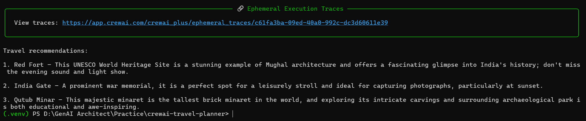
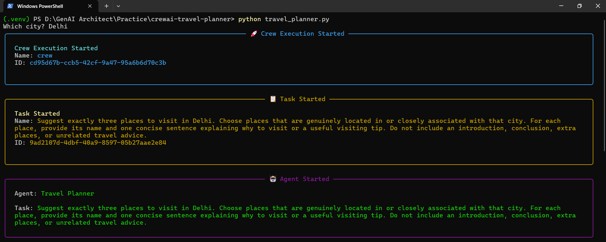
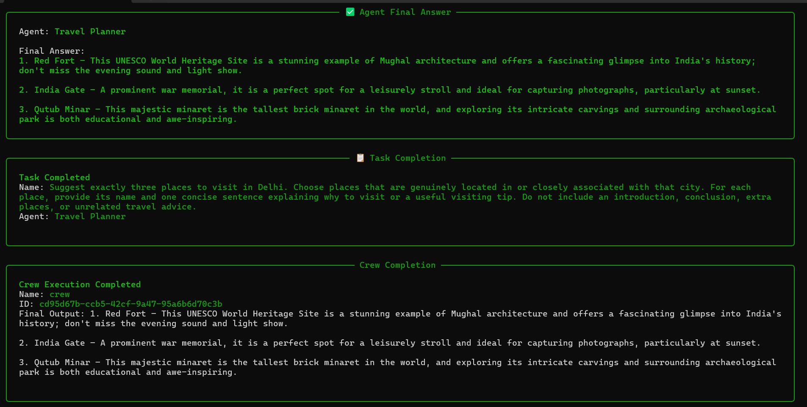

# CrewAI Travel Planner

A minimal terminal-based travel planner built with Python and CrewAI. Enter a city and the agent recommends exactly three places to visit, each with a concise reason or practical tip.

## Screenshots

<!-- Save genuine screenshots in the screenshots/ folder after running the app. Replace the placeholder paths below. -->
<table>
  <tr>
    <td width="33%" align="center">
      <strong>Final three travel recommendations</strong><br>
      
    </td>
    <td width="33%" align="center">
      <strong>Execution</strong><br>
      
    </td>
    <td width="33%" align="center">
      <strong>Completion</strong><br>
      
    </td>
  </tr>
</table>

## Features

- Accepts a city name from terminal input.
- Uses one CrewAI Agent, one Task, and one Crew.
- Requests exactly three numbered recommendations.
- Reads the OpenAI API key and model name from environment variables.
- Enables verbose CrewAI output for observing the agent's execution.

## Requirements

- Windows with Python installed.
- An OpenAI API key with access to the selected model.
- Internet access while the agent runs.

## Setup (Windows PowerShell)

Open PowerShell in the project folder and run:

```powershell
py -m venv .venv
.\.venv\Scripts\Activate.ps1
python -m pip install --upgrade pip
pip install -r requirements.txt
```

If PowerShell blocks virtual-environment activation, use this for the current PowerShell process only, then activate again:

```powershell
Set-ExecutionPolicy -Scope Process -ExecutionPolicy Bypass
.\.venv\Scripts\Activate.ps1
```

## Configure credentials

Set the key and model in the .env:

```powershell
OPENAI_API_KEY=your_openai_api_key_here
MODEL=openai/gpt-4o-mini
```

Replace the placeholder with your own API key. Do not commit the key to GitHub. The model variable can be changed to another model identifier your API account can access.

## Run

```powershell
python travel_planner.py
```

Enter a city when prompted. The verbose agent execution appears in the terminal, followed by the final three recommendations.

## Verification

Run the program separately for at least three cities and check that:
- the script asks for a city;
- verbose agent output appears;
- the final answer contains exactly three numbered places;
- recommendations change appropriately between cities.

Capture a screenshot showing the verbose output and final answer. Also record the script running for the video demonstration. Replace the demo placeholder with the actual GitHub-uploaded video URL. Add genuine screenshots under `screenshots/` so the relative image links work.

## Project structure

```text
crewai-travel-planner-basic/
├── travel_planner.py
├── requirements.txt
├── .env.example
├── .gitignore
├── README.md
└── screenshots/
└──── demo-0.png
└──── demo-1.png
└──── demo-2.png
```

## Notes and limitations

- Recommendations are generated by an LLM and may be inaccurate or outdated. Verify opening hours, access, and travel details independently.
- API usage may incur charges according to your OpenAI account and model pricing.
- This is a terminal application; it does not use a map, booking service, or live attraction database.
